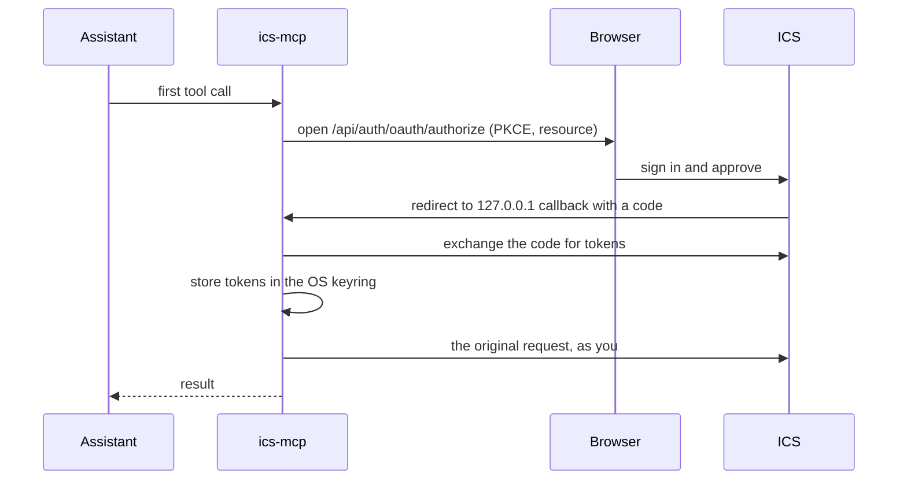

<div align="center">

<a href="https://github.com/inprojectspl/ics">
  <picture>
    <source media="(prefers-color-scheme: dark)" srcset="docs/images/logo-lockup-white.svg">
    
  </picture>
</a>

## ics-mcp

### Connect your AI assistant to ICS, with your own permissions

An [MCP](https://modelcontextprotocol.io) server that lets Claude, Cursor and any other MCP
client read, write, version and share documents in
[ICS (Internal Content Sharing)](https://github.com/inprojectspl/ics), a self-hosted platform for
sharing team documents.

[](./LICENSE)
[](./pyproject.toml)
[](https://modelcontextprotocol.io/specification/2025-11-25)
[](https://gofastmcp.com)
[](#tools)

[User guide](https://inprojectspl.github.io/ics-mcp/) ·
[Quick start](#quick-start) ·
[Configuration](#configuration) ·
[Tools](#tools) ·
[HTTP mode](#http-mode) ·
[ChatGPT](docs/guide/chatgpt.md) ·
[Security](#security-model) ·
[Development](#development)

</div>

<br>

> **You:** List my pinned notes in the Architecture project, show the latest diff of adr-007
> and share it with an SSO link that expires on Friday.
>
> **Assistant:** *calls `ics_assets_list`, `ics_asset_diff` and `ics_share_create_link`, then
> answers with the diff and the new link.*

## Highlights

- **Acts as you, never more.** Every tool call is a request to the ICS user-level API with the
  signed-in user's OAuth token. No shared service account and no administration tools; an
  administrator's token still carries that administrator's access.
- **53 tools with full MCP annotations** for discovery, reading, Markdown and HTML writes, PDF and
  Word documents, versions, sharing, the relation graph and task context.
- **Safe destructive operations.** Deletes and overwrites go through a confirmation gate:
  interactive elicitation, scripted `yolo` (only when the operator allows it) or `dry_run`.
- **Two transports.** `stdio` for a local assistant with sign-in through your browser, and
  Streamable HTTP for remote clients such as claude.ai connectors.
- **Token efficient.** Compact responses cut to a size budget, outlines before full reads,
  section reads by heading, and a single call that gathers the documents of a task.
- **Standards first.** OAuth 2.1 with PKCE S256, RFC 8707 resource indicators, RFC 9728
  protected resource metadata and RS256 JWTs verified against the ICS JWKS.

## Documentation

The [user guide](https://inprojectspl.github.io/ics-mcp/) explains, for people who use ICS through an assistant,
how to connect a client and sign in, what to ask for everyday tasks, how confirmations work and
how to fix common errors. This README is the reference for tools and configuration.

For ChatGPT, follow [Connect ChatGPT to ICS](docs/guide/chatgpt.md): it covers remote HTTP,
OAuth discovery, Google Workspace sign-in, permission checks and the current file-upload limits.

## Quick start

You need a running [ICS](https://github.com/inprojectspl/ics) with `ICS_MCP_RESOURCE_URI` set (ICS
then registers the public clients `ics-mcp-stdio` and `ics-mcp-http`) and
[uv](https://docs.astral.sh/uv/).

### 1. Add the server to your MCP client

Claude Desktop (`claude_desktop_config.json`), Claude Code (`.mcp.json` or `claude mcp add`)
and Cursor (`~/.cursor/mcp.json`) all accept this shape:

```jsonc
{
  "mcpServers": {
    "ics": {
      "command": "uvx",
      "args": ["--from", "git+https://github.com/inprojectspl/ics-mcp", "ics-mcp"],
      "env": {
        "ICS_BASE_URL": "https://ics.example.com",
        "ICS_MCP_RESOURCE_URI": "https://ics.example.com/mcp"
      }
    }
  }
}
```

Pin a tag or a commit for reproducible setups, for example
`git+https://github.com/inprojectspl/ics-mcp@<tag>`. Restart the client after editing its
configuration.

### 2. Ask your assistant about ICS

The first tool call opens your browser at the ICS sign-in and consent screen. After you approve,
the tokens are stored in the OS keyring and the call continues. That's it.

<details>
<summary><b>Other ways to install</b></summary>

<br>

**From a local checkout**

```bash
git clone https://github.com/inprojectspl/ics-mcp && cd ics-mcp
uv sync
uv run ics-mcp
```

In a client configuration use `"command": "uv"` with
`"args": ["--directory", "/path/to/ics-mcp", "run", "ics-mcp"]`.

**PyPI** is planned but not published yet.

</details>

## Configuration

Every setting is an environment variable, see [`ics_mcp/config.py`](./ics_mcp/config.py) and
[`.env.example`](./.env.example).

<details>
<summary><b>All variables</b></summary>

<br>

| Variable | Default | Meaning |
|---|---|---|
| `ICS_BASE_URL` | `http://ics.localhost` | Address the server uses to reach ICS. Can be an internal address in HTTP deployments; JWKS is fetched from here. |
| `ICS_MCP_RESOURCE_URI` | `http://ics.localhost/mcp` | Canonical URI of this MCP server. Must match `ICS_MCP_RESOURCE_URI` on the ICS side: tokens carry it as `aud` (RFC 8707). Required in HTTP mode. |
| `ICS_MCP_OAUTH_CLIENT_ID` | `ics-mcp-stdio` | Public PKCE client registered in ICS. |
| `ICS_MCP_OAUTH_ISSUER` | same as `ICS_BASE_URL` | Public ICS URL, the `iss` of its tokens. Set it when `ICS_BASE_URL` is internal. |
| `ICS_MCP_TRANSPORT` | `stdio` | `stdio` or `http`. |
| `ICS_MCP_HTTP_HOST` | `127.0.0.1` | HTTP bind address. |
| `ICS_MCP_HTTP_PORT` | `8765` | HTTP port. |
| `ICS_MCP_STATELESS` | `false` | Stateless HTTP for several replicas, see [HTTP mode](#http-mode). |
| `ICS_MCP_EXTRA_ORIGINS` | empty | Comma-separated browser origins allowed besides the server's own. |
| `ICS_MCP_KEYRING_SERVICE` | `ics-mcp` | Keyring service name. Use different names to keep several token profiles. |
| `ICS_MCP_TOKEN_FALLBACK_PATH` | platform data dir, `credentials.json` (`credentials-<service>.json` for another keyring service) | Token file used when no OS keyring is available. |
| `ICS_MCP_DEFAULT_CONFIRM` | `interactive` | Initial confirm mode: `interactive`, `yolo` or `dry_run` (`ask` is a legacy alias of `interactive`). |
| `ICS_MCP_ALLOW_YOLO` | `false` | Whether the model may switch its own session to `yolo`. |
| `ICS_MCP_LOG_LEVEL` | `INFO` | `DEBUG`, `INFO`, `WARNING`, ... |
| `ICS_MCP_MAX_UPLOAD_BYTES` | `104857600` (100 MiB) | Upload size cap, checked before files are read into memory. |
| `ICS_MCP_MAX_UPLOAD_FILES` | `500` | Maximum number of files in one upload. |
| `ICS_MCP_RESPONSE_MAX_CHARS` | `8000` | Response size budget for text payloads. |
| `ICS_MCP_HTTP_TIMEOUT_READ` | `30` | Read timeout for ICS requests, in seconds. |
| `ICS_MCP_HTTP_TIMEOUT_WRITE` | `300` | Write timeout for ICS requests (uploads), in seconds. |

</details>

## Signing in (stdio)



- The loopback callback binds to `127.0.0.1` on a random port and checks `Host` and `state`.
  The flow times out after 5 minutes.
- Access tokens are RS256 JWTs; refresh tokens rotate. On a `401` the server refreshes once and
  retries without the assistant noticing. Reusing a rotated refresh token revokes the whole
  token family in ICS.
- Tokens are stored in the macOS Keychain, Windows Credential Manager or libsecret under service
  `ics-mcp`, account `default`.
- **Headless environments** (no `$DISPLAY` or `$BROWSER`, and `CI` or `ICS_MCP_FORCE_HEADLESS`
  set): no browser opens and no loopback callback runs, so the tool returns `auth_required` with
  the `authorization_url` and the sign-in cannot finish there. Sign in on a machine with a
  browser, or run the server in [HTTP mode](#http-mode).
- **Signing out**: delete the keyring entry (see [Troubleshooting](#troubleshooting)). The
  refresh token on the ICS side expires on its own (30 days by default).

## HTTP mode

With `ICS_MCP_TRANSPORT=http` the server speaks Streamable HTTP on `/mcp`, for remote clients
such as claude.ai connectors:

```bash
ICS_MCP_TRANSPORT=http \
ICS_BASE_URL=http://backend:8000 \
ICS_MCP_OAUTH_ISSUER=https://ics.example.com \
ICS_MCP_RESOURCE_URI=https://mcp.ics.example.com/mcp \
ICS_MCP_HTTP_HOST=0.0.0.0 \
uvx --from git+https://github.com/inprojectspl/ics-mcp ics-mcp
```

- A request without a valid bearer token gets `401` with a `WWW-Authenticate` header pointing at
  the RFC 9728 metadata, which names ICS as the authorization server, so clients run the OAuth
  flow against ICS on their own.
- Tokens are verified against the ICS JWKS (signature, issuer, audience, expiry), and every call
  to ICS carries the caller's own token. The server keeps no shared token store.
- `content_path` arguments are refused, and a request whose `Origin` is neither the server's own
  nor in `ICS_MCP_EXTRA_ORIGINS` gets `403`.
- `GET /health` returns `{status, version, protocol_version}` without calling ICS.
- Sessions and their confirm mode live in process memory. For several replicas set
  `ICS_MCP_STATELESS=true`; the confirm mode then falls back to `ICS_MCP_DEFAULT_CONFIRM`.

Run it behind a TLS-terminating reverse proxy that does not buffer `text/event-stream`.
[`deploy/`](./deploy) has a Dockerfile, a compose snippet, an example Caddyfile and a
[deployment guide](./deploy/README.md).

For a custom ChatGPT connection, see the [ChatGPT guide](docs/guide/chatgpt.md). Before connecting,
check the public discovery routes without signing in or calling any tools:

```bash
uv run python scripts/check_remote.py \
  --mcp-url https://mcp.ics.example.com/mcp \
  --issuer https://ics.example.com
```

## Tools

53 tools. Every one declares all four MCP annotations (`readOnlyHint`, `destructiveHint`,
`idempotentHint`, `openWorldHint`) and returns structured content. Documents are addressed by
`slug_or_id` (a slug or a UUID), except `ics_asset_undelete`, which needs the UUID.
`ics_help` returns longer guides to the assistant.

| Group | Tools |
|---|---|
| Session and help | `ics_help`, `ics_whoami`, `ics_session_set_mode`, `ics_session_status` |
| Discovery | `ics_assets_list`, `ics_assets_search`, `ics_asset_meta`, `ics_asset_list_files`, `ics_asset_outline`, `ics_projects_list`, `ics_shares_list` |
| Read | `ics_asset_read`, `ics_asset_ocr`, `ics_asset_read_rendered`, `ics_asset_versions`, `ics_asset_diff`, `ics_share_resolve` |
| Write Markdown | `ics_asset_create_md`, `ics_asset_create_collection`, `ics_asset_rename`, `ics_asset_update_content`, `ics_asset_add_file`, `ics_asset_create_empty_file`, `ics_asset_move_file`, `ics_asset_delete_file`, `ics_asset_delete`, `ics_asset_undelete`, `ics_asset_pin`, `ics_asset_set_tags` |
| HTML bundles | `ics_asset_create_html`, `ics_asset_html_replace_bundle`, `ics_asset_html_security_review` |
| PDF and Word | `ics_asset_create_document`, `ics_asset_replace_document` |
| Metadata | `ics_doc_types`, `ics_asset_set_meta` |
| Relation graph | `ics_asset_relations`, `ics_relation_add`, `ics_relation_update`, `ics_relation_remove`, `ics_graph_neighbourhood`, `ics_asset_rescan_relations` |
| Tasks | `ics_task_context`, `ics_task_link`, `ics_task_unlink`, `ics_asset_external_refs`, `ics_project_links`, `ics_project_links_set` |
| Versions | `ics_asset_new_version`, `ics_asset_restore_version` |
| Sharing | `ics_share_create_link`, `ics_share_grant_user`, `ics_share_revoke` |

Tools that take file content accept inline content or `content_path`, a local path the server
reads from disk (stdio only), which keeps large files out of the model's context.

<details>
<summary><b>Full tool reference</b></summary>

<br>

**Session and help**

| Tool | Purpose |
|---|---|
| `ics_help(topic?)` | Guides: `overview`, `workflows`, `tools`, `tool-selection`, `confirm`, `auth`, `graph`, `task-context`. |
| `ics_whoami()` | The signed-in user, scope and client. |
| `ics_session_set_mode(mode)` | Confirm mode for this session: `interactive`, `yolo`, `dry_run`. |
| `ics_session_status()` | Current mode, server and protocol versions. |

**Discovery**

| Tool | Purpose |
|---|---|
| `ics_assets_list(kind?, project_id?, pinned?, shared_with_me?, owned?, tag?, doc_type?, freshness?, updated_since?, touched_since?, q?, limit?, cursor?)` | Paginated list with filters, 20 per page by default and cut to the response limit. Compact items carry the summary preview, document type, freshness, maintainer, successor and estimated tokens. `updated_since` means a content change, `touched_since` any change. The cheapest first step. |
| `ics_assets_search(q, kind?, project_id?, doc_type?, tag?, freshness?, limit?, offset?, detail?, match?)` | Full-text search in Markdown, PDF text and converted Word/ODF documents. All words by default, accent-insensitive prefixes and quoted phrases; `match="any"` broadens. Continue with `next_offset`. `detail="full"` returns ids, scores and highlights. |
| `ics_asset_meta(slug_or_id)` | Metadata only, with the full summary. |
| `ics_asset_list_files(slug_or_id, version?)` | Files of a collection or bundle, optionally of an older version. |
| `ics_asset_outline(slug_or_id, wait?, edges?, max_level?, offset?)` | Structure (headings with `line`, `end_line` and `anchor`, files, wikilink graph) without content; outgoing relations with `edges=true`. |
| `ics_projects_list()` | Projects visible to the user. |
| `ics_shares_list(slug_or_id)` | Share links and user grants of a document. |

**Read**

| Tool | Purpose |
|---|---|
| `ics_asset_read(slug_or_id, path?, anchor?, lines?, encoding?, format?, max_lines?, version?)` | File content: a line range, one section by heading `anchor` (`ics://asset/<slug>#<anchor>` works too) or an older version. A PDF reads as Markdown with one `## Page N` section per page, a Word/ODF document as its converted Markdown. |
| `ics_asset_ocr(slug_or_id, request?)` | OCR state of a scanned PDF (queued, running, done, failed); `request=True` queues OCR of the current version or retries it. |
| `ics_asset_read_rendered(slug_or_id, version?)` | Rendered HTML. Expensive; prefer `ics_asset_read`. |
| `ics_asset_versions(slug_or_id)` | Version history with authors. |
| `ics_asset_diff(slug_or_id, v1, v2, path?)` | Diff between two versions. |
| `ics_share_resolve(share_link, password?, path?, lines?)` | Read a document from a share link or token. |

**Write: Markdown**

| Tool | Purpose |
|---|---|
| `ics_asset_create_md(title, content? \| content_path?, share_mode?, project_id?, tags?, doc_type?, summary?)` | New single Markdown document. |
| `ics_asset_create_collection(title, files, entry_path?, share_mode?, project_id?, tags?, doc_type?, summary?)` | New Markdown collection. Reports progress. |
| `ics_asset_rename(slug_or_id, title)` | Change the title; the slug stays. |
| `ics_asset_update_content(slug_or_id, content? \| content_path?, path?, confirm?)` | Replace a file's content as a new version. Destructive. |
| `ics_asset_add_file(slug_or_id, path, content? \| content_path?)` | Add a file to a collection. |
| `ics_asset_create_empty_file(slug_or_id, path, change_note?)` | Add an empty file to a collection. |
| `ics_asset_move_file(slug_or_id, from_path, to_path, confirm?)` | Move or rename a file in a collection. Destructive. |
| `ics_asset_delete_file(slug_or_id, path, confirm?)` | Delete a file from a collection. Destructive. |
| `ics_asset_delete(slug_or_id, confirm?)` | Soft-delete a document. Destructive. |
| `ics_asset_undelete(asset_id)` | Restore a soft-deleted document (UUID only). Share links are not restored. |
| `ics_asset_pin(slug_or_id, pinned?)` | Pin, or with `pinned=false` unpin. |
| `ics_asset_set_tags(slug_or_id, tags)` | Replace the tag list. |

**Write: HTML bundles**

| Tool | Purpose |
|---|---|
| `ics_asset_create_html(title, entry_path, files, share_mode?, project_id?, tags?, doc_type?, summary?)` | Upload a bundle; each file has `path` and one of `content_text`, `content_base64` or `content_path`. ICS scans it for security issues. |
| `ics_asset_html_replace_bundle(slug_or_id, entry_path, files, confirm?)` | Replace the whole bundle as a new version. Destructive. |
| `ics_asset_html_security_review(slug_or_id)` | Security scan status and findings. |

**Write: PDF and Word/ODF documents**

| Tool | Purpose |
|---|---|
| `ics_asset_create_document(file_path, title?, share_mode?, project_id?, tags?, doc_type?, summary?)` | Upload a local `.pdf` (becomes `pdf_doc`, text extracted, scanned pages through OCR) or `.docx`, `.odt`, `.doc` (becomes `office_doc`, converted to Markdown). ICS scans the file for scripts, launch actions, macros and remote templates. stdio only. |
| `ics_asset_replace_document(slug_or_id, file_path, confirm?)` | Upload a new file as the next version of a `pdf_doc` or `office_doc`. Destructive; history is kept. |

**Document metadata**

| Tool | Purpose |
|---|---|
| `ics_doc_types()` | Document types for `doc_type`: key, label, agent hint, default review interval. |
| `ics_asset_set_meta(slug_or_id, summary?, doc_type?, maintainer_email?, review_due_at?, language?, properties?)` | Change metadata without a new version; `""` clears a field. |

**Relation graph**

| Tool | Purpose |
|---|---|
| `ics_asset_relations(slug_or_id, types?, direction?, detail?)` | Relations as compact `[from, type, to, {id, ...}]` edges plus the other ends by slug. |
| `ics_relation_add(source, target, relation_type, target_path?, target_anchor?, note?, confirm?)` | Record a typed relation: `derived_from`, `supersedes`, `depends_on`, `part_of`, `references`, `relates_to`, `duplicates`, `contradicts`. Goes through the confirmation gate. |
| `ics_relation_update(relation_id, note?, refresh_target_version?)` | Change the note, or mark a changed target as checked. |
| `ics_relation_remove(relation_id, confirm?)` | Delete a relation. Destructive. |
| `ics_graph_neighbourhood(slug_or_id, depth?, types?, direction?, max_nodes?, detail?)` | Nodes and `[from, type, to]` edges around a document (depth up to 3), with metadata to decide where to go next; `skipped` counts edges of types left out. |
| `ics_asset_rescan_relations(slug_or_id)` | Extract links to ICS documents from the current content again and record them as `references` edges. Needs editor. |

**Tasks**

| Tool | Purpose |
|---|---|
| `ics_task_context(wp, project?, ancestors?, system?, scope?, depth?, budget_tokens?, include?)` | The documents of one task in one call: required, linked, inherited from ancestors, project key documents and graph neighbours, ordered and cut to `budget_tokens`. |
| `ics_task_link(slug_or_id, wp, role, system?, project?, required?, path?, pinned_version?, note?, label?)` | Link a document to an OpenProject work package or a Project Standard node as `context`, `deliverable` or `reference`. |
| `ics_task_unlink(ref_id, confirm?)` | Delete a task link. Destructive. |
| `ics_asset_external_refs(slug_or_id)` | Tasks a document is linked to. |
| `ics_project_links(project_slug)` | External projects mapped to an ICS project, and its key documents. |
| `ics_project_links_set(project_slug, set_external?, key_documents?, confirm?)` | Replace them (owner). Destructive; `[]` clears a list and needs `confirm=true` even in `yolo`. |

**Versions**

| Tool | Purpose |
|---|---|
| `ics_asset_new_version(slug_or_id, files, entry_path?, change_note?, confirm?)` | New version replacing the whole file set. Destructive. |
| `ics_asset_restore_version(slug_or_id, version, confirm?)` | Make an older version current again. Destructive; history is kept. |

**Sharing**

| Tool | Purpose |
|---|---|
| `ics_share_create_link(slug_or_id, mode, password?, allowed_emails?, expires_at?, max_views?, confirm?)` | Create a link: `org_sso`, `password`, `public` or `magic_email`. `public` needs confirmation. |
| `ics_share_grant_user(slug_or_id, email, role)` | Grant a user `editor` or `viewer` access. |
| `ics_share_revoke(share_id? \| slug_or_id + user_id, confirm?)` | Disable a share link or revoke a user grant permanently. Destructive. |

</details>

## Confirmations and destructive operations

Operations that delete or replace content, add or remove relations, unlink tasks, replace
project links, create a `public` share link or create a document with `share_mode="public"` go
through a confirmation gate. The session mode
decides what happens:

| Mode | Behaviour |
|---|---|
| `interactive` (default) | The client asks the user through MCP elicitation. A client without elicitation gets `confirm_required`, with a hint to pass `confirm=true` after asking the user. |
| `yolo` | No questions, for scripted or scheduled agents. The model can switch to `yolo` only when the operator set `ICS_MCP_ALLOW_YOLO=true` or `ICS_MCP_DEFAULT_CONFIRM=yolo`, so an injected instruction cannot turn confirmations off. |
| `dry_run` | Destructive tools return a preview of what they would do and send nothing to ICS. |

The per-call `confirm` argument always wins: `confirm=true` runs without asking,
`confirm=false` refuses in every mode, and an omitted `confirm` follows the session mode.

## Resources and prompts

| Resource | Content |
|---|---|
| `ics://index` | The first page of the user's documents. |
| `ics://asset/{slug}` | Metadata plus content (single Markdown) or outline (collection, bundle). |
| `ics://asset/{slug}/outline` | The outline only. |
| `ics://asset/{slug}/file/{path}` | One file of a collection as text. |
| `ics://asset/{slug}@v{version}` | An archived version: its content or its file list. |
| `ics://asset/{slug}@v{version}/file/{path}` | One file of an archived version as text. |
| `ics://project/{slug}` | Project metadata and its documents. |

| Prompt | Workflow |
|---|---|
| `share_with_team(asset_slug, mode, password_hint?)` | Create a share link and suggest how to send it. |
| `summarize_collection(slug, max_files?)` | Outline, pick files, read them, summarize. |
| `migrate_to_collection(source_slug, new_title, first_filename)` | Turn a single Markdown document into a collection. |

## Rate limits and retries

ics-mcp assumes no limits of its own and reacts to what ICS answers:

- `429` is retried up to 3 times, waiting as long as `Retry-After` says (at most 30 s per
  wait, 1 s without the header), for every method, since ICS did not process the request. When
  the retries run out the tool returns `rate_limited`.
- `502`, `503` and `504` are retried with growing delays only for `GET`, `HEAD` and `OPTIONS`.
  Writes that fail this way go back to the assistant at once, because ICS may have applied them.

For bulk work, page through `ics_assets_list` with `cursor` and filter there, and replace many
files in one `ics_asset_new_version` call instead of many `ics_asset_update_content` calls.

## Security model

- **Scope of access**: exactly what the signed-in user can do in ICS (own documents, documents
  shared with them, their projects), and nothing more. Tokens are never returned to the
  assistant; `ics_whoami` shows only the client, scope and audience.
- **Audience binding (RFC 8707)**: tokens are issued for this server's resource URI; in HTTP
  mode tokens with another `aud` are rejected.
- **No token passthrough**: tokens go only to ICS, which is both the authorization and the
  resource server.
- **Token storage**: the OS keyring first. The fallback file is created with mode `0600` and
  obfuscated with Fernet using a key derived from the host and user ID, which protects against
  accidental reading, not against code running as the same user.
- **HTTP transport**: `Origin` validation as the MCP spec requires, and `content_path` disabled.
- **Logs**: always on stderr (stdout carries the stdio protocol) and never with tokens; a test
  enforces it.

Please report vulnerabilities privately as described in [SECURITY.md](./SECURITY.md).

## Troubleshooting

<details>
<summary><b><code>auth_required</code> although you signed in (stdio)</b></summary>

<br>

The refresh failed or the tokens were revoked. Delete the keyring entry and call a tool again:

```bash
# macOS
security delete-generic-password -s ics-mcp -a default
# Linux (libsecret)
secret-tool clear service ics-mcp username default
# Windows
cmdkey /delete:ics-mcp
```

</details>

<details>
<summary><b><code>401</code> in HTTP mode</b></summary>

<br>

Check that `ICS_MCP_RESOURCE_URI` is identical on the ICS and the MCP side, that
`ICS_MCP_OAUTH_ISSUER` matches the `iss` of ICS tokens, and that the client supports dynamic
client registration (or use a client pre-registered in ICS).

</details>

<details>
<summary><b><code>403</code> from the loopback callback, or ICS unreachable</b></summary>

<br>

A `403` means the request did not come from `127.0.0.1` or had a wrong `state`, usually because
a proxy or VPN intercepts loopback traffic; exclude `127.0.0.1` from it. If ICS is unreachable,
check `ICS_BASE_URL` (with the scheme), that ICS is up, and firewalls or DNS.

</details>

<details>
<summary><b>Debugging and manual testing</b></summary>

<br>

Run with `ICS_MCP_LOG_LEVEL=DEBUG` and read the server's stderr (in Claude Desktop: Settings,
Developer, Open MCP Logs). The MCP Inspector lists the tools and lets you call them:

```bash
npx @modelcontextprotocol/inspector \
  -e ICS_BASE_URL=https://ics.example.com \
  -e ICS_MCP_RESOURCE_URI=https://ics.example.com/mcp \
  uvx --from git+https://github.com/inprojectspl/ics-mcp ics-mcp
```

</details>

## Development

```bash
git clone https://github.com/inprojectspl/ics-mcp && cd ics-mcp
uv sync --extra dev
uv run ruff check . && uv run ruff format --check .
uv run mypy --strict ics_mcp
uv run pytest --cov=ics_mcp --cov-fail-under=85
```

The tests mock ICS with `respx` and use an in-memory keyring, so they need neither a running
ICS nor network access. See [CONTRIBUTING.md](./CONTRIBUTING.md) for the workflow and
conventions, [CHANGELOG.md](./CHANGELOG.md) for releases and [AGENTS.md](./AGENTS.md) for notes
aimed at AI coding agents.

## License

ics-mcp is released under the [MIT License](./LICENSE). The inProjects.ai name and logo are not
covered by it, see [NOTICE](./NOTICE).

<br>

<div align="center">
  <sub>Built by</sub>
  <br>
  <a href="https://inprojects.ai">
    <picture>
      <source media="(prefers-color-scheme: dark)" srcset="docs/images/inprojects-logo-white.svg">
      
    </picture>
  </a>
</div>
