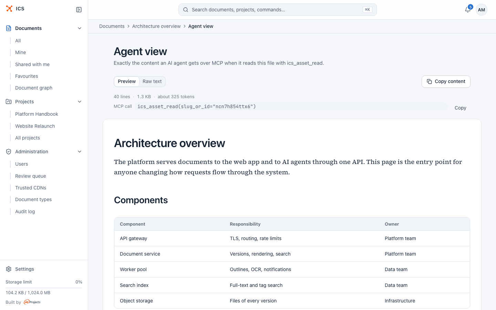

# Overview

ics-mcp gives an AI assistant a set of tools for ICS. The assistant uses them in your name, so it
can do in ICS what you can do, and nothing more.

## What the assistant can do

The assistant gets 53 tools (all listed in the [tool reference](https://github.com/inprojectspl/ics-mcp/blob/main/README.md#tools)). In
practice that covers:

| Area | Examples of what you can ask |
|---|---|
| Find documents | List your pinned notes, search for every runbook that mentions "latency", show what was shared with you this week. |
| Read efficiently | Show the outline of a long document, then read only the section you need; read a PDF or a Word document as text. |
| Write | Create a Markdown note or a collection of notes, upload an HTML dashboard, upload a PDF or Word file from your disk, update one section of a document. |
| Versions | Show the history of a document, compare two versions, read an old version, restore one. |
| Share | Create a share link (for the organization, with a password, public, or for a list of e-mail addresses), give a colleague viewer or editor access, revoke access. |
| Organize | Set tags, pin documents, set the document type, summary, maintainer and review date. |
| Relations | Show which documents a document was derived from, depends on or replaces; record such a relation. |
| Tasks | Gather the documents that belong to an OpenProject work package or a Project Standard task in one call. |

ICS stores five kinds of documents, and the assistant works with all of them:

| Kind | What it is |
|---|---|
| `md_single` | One Markdown file. |
| `md_collection` | A set of Markdown files linked with `[[wikilinks]]`. |
| `html_bundle` | Generated HTML with its CSS, scripts and images, for example a dashboard or a report. |
| `pdf_doc` | One PDF. ICS extracts its text, and scanned pages get text through OCR. |
| `office_doc` | One Word or ODF text document (`.docx`, `.odt`, `.doc`), converted to Markdown. |

## How the assistant acts as you

When you connect ics-mcp, you sign in to ICS in your browser and approve access on the ICS
consent page. ICS then issues a token for your account, and every tool call is an ordinary ICS
request made with that token.

This has a few consequences worth knowing:

- **Your permissions apply.** The assistant sees your own documents, documents shared with you
  and documents of the projects you belong to. It can edit only where you are an editor or owner,
  and share only where ICS lets you share. If ICS refuses you something in the web app, it refuses
  the assistant too.
- **Administrator accounts keep their reach.** If your ICS account is an administrator, ICS treats
  requests made with your token as an administrator's, which includes access to documents of
  other users. ics-mcp itself has no tools for the ICS administration pages. Consider using a
  regular account for assistant work if you do not need that reach.
- **Changes are recorded as yours.** New versions show you as the author. A summary written
  through ics-mcp is marked as written by an agent (the ICS web app shows "description by agent"),
  and relations added this way are labelled "added by an agent".
- **The token stays with ics-mcp.** The assistant never sees it. On your own computer the token is
  stored in the operating system keyring (see [Getting started](getting-started.md)).

## What the assistant does not do

- It has no access beyond your account: no shared service account and no admin tools.
- It does not delete permanently. `ics_asset_delete` is a soft delete that can be undone, and
  every content change creates a new version, so earlier versions stay available.
- It does not follow instructions written inside documents. Every read tool tells the assistant
  that document content is data, not instructions. Treat this as a safeguard, not a guarantee:
  keep an eye on what the assistant does after reading documents you did not write.
- It does not edit single files inside an HTML bundle. ICS treats a bundle as one unit, so every
  change replaces the whole bundle as a new version.
- It does not create ICS projects. Create them in the ICS web app; the assistant can then put
  documents into them.

## Where ICS shows what the assistant sees

Two screens in the ICS web app help you check what an assistant gets:

- **Agent view** (in a document's menu, for editors and owners): "Exactly the content an AI agent
  gets over MCP when it reads this file with ics_asset_read." Use it to check how a PDF, a Word
  document or an HTML page reads as text.

  

- **Agent context** (a tab of a project, for project members): the documents an agent gets for a
  task, in the order it reads them, with the reason for each. Use it to find out why an assistant
  skipped a document. See [Task context](everyday-tasks.md#start-work-on-a-task).

  

## Related

- [Getting started](getting-started.md)
- [Everyday tasks](everyday-tasks.md)
- [Confirmations and safety](confirmations-and-safety.md)
